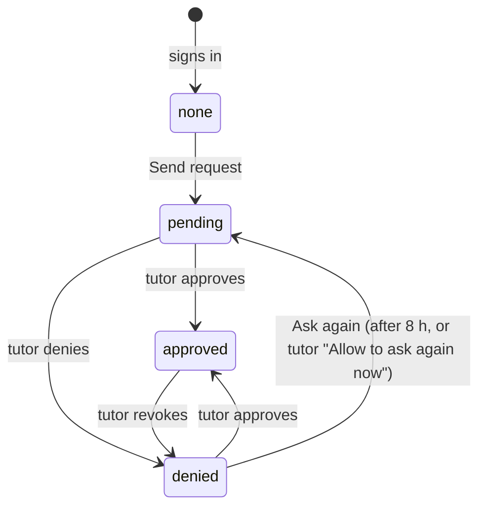

# Design: access requests and approval

Scope: ADR 0006 + 0007. Tutee `/access`, tutor `/access-requests`, navigation and home by role, final tutee `/availability`. Mobile first, WCAG 2.2 AA. Tokens and components from `skeleton.md` / `availability-calendar.md`; **no new tokens**.

**Layout principle (owner wants to restyle later):** every page here is a single column inside `Container`: `PageHeading` → optional live `StatusMessage` → one content block. No page-specific CSS beyond the new components' own modules; all colour, spacing and type come from tokens, so a restyle means editing tokens and 4 small component modules, not pages. Page components only compose; state is chosen by one pure function per page (see §8).

## 1. Flow



## 2. Navigation and home by role

Header nav (`<nav aria-label="Main">`, wraps, no hamburger; ≥44px; `aria-current="page"` + underline). Sign in / Sign out stays in the existing `AuthControls` slot at the end.

| Visitor | Nav items | Notes |
|---|---|---|
| Signed out | Home · Sign in | |
| Tutee, `none` | Home · Request access | |
| Tutee, `pending` | Home · Request status | label differs so the purpose is clear |
| Tutee, `denied` | Home · Request status | |
| Tutee, `approved` | Home · Availability | |
| Tutor | Home · Calendar · Access requests `(n)` | `(n)` = pending count, only if > 0; the link's accessible name is "Access requests, 3 pending" (visible text "Access requests" + `<span class="visually-hidden">, 3 pending</span>` + visible badge `3` `aria-hidden`). Count loaded once per session and refreshed on focus; failure = no badge. |

Nav is data: `getNavItems(user | null, pendingCount): NavItem[]` (pure, unit-tested). Layout just renders the list.

Home (`/`), `PageHeading` "Tutoring"; below the heading exactly one block:

| State | Lead | Block |
|---|---|---|
| Checking | "Personal tutoring sessions." | `StatusMessage info` "Checking your sign-in..." |
| Signed out | "Personal tutoring sessions. Sign in to ask for access and see when I'm free." | `ButtonLink` "Sign in" → `/login` |
| `none` | "You're signed in. Ask for access to see my availability." | `ButtonLink` "Request access" → `/access` |
| `pending` | same | `StatusMessage info` "Your request is waiting for the tutor." + `ButtonLink secondary` "See request status" |
| `denied` | same | `StatusMessage warning` "You don't have access right now." + `ButtonLink secondary` "See request status" |
| `approved` | "You have access." | `ButtonLink` "See availability" → `/availability` |
| Tutor | "Manage your calendar and access requests." | `ButtonLink` "Go to calendar" + `ButtonLink secondary` "Access requests" (pending count in text when > 0: "Access requests (3 pending)") |
| After sign-out | unchanged | `StatusMessage success` "You have been signed out." (existing) |

Signed-in users opening `/login` are redirected to their home target (`/access`, `/availability` or `/calendar`). Document titles: `Request access · Tutoring`, `Access requests · Tutoring`, `Availability · Tutoring`.

## 3. Tutee page `/access`

Guard: `RequireAuth`. Approved tutees → redirect `/availability`; tutor → redirect `/access-requests`. One `h1` "Request access" (title varies by state, see table). View is chosen by `getAccessView(request)`; each view is a small presentational component so it can be restyled alone.

A **persistent live region** (`StatusAnnouncer`, §7) sits under the heading; content changes announce (e.g. after submit: "Request sent."). After a state change caused by the user (submit, ask again, check again) focus moves to the new view's `h2`/status (`tabIndex=-1`).

| State | h1 | Content |
|---|---|---|
| Loading | "Request access" | `StatusMessage info` "Loading your request..." (`aria-busy`) |
| Signed out | n/a | `RequireAuth` redirects to `/login` with return path `/access`; Login page text for that case: "Sign in to ask the tutor for access." |
| `none` | "Request access" | `AccessRequestForm` (below) |
| `pending` | "Request sent" | `StatusMessage info` title "Waiting for the tutor": "I got your request on Tue 24 Nov, 14:05. You'll be able to see my availability once I say yes." • "Your message" quote block (text only; or muted "You didn't add a message.") • `Button secondary` "Check again" (loading label kept; result announced: "Still waiting." or the view switches) • muted help: "Come back later; this page doesn't refresh by itself." |
| `approved` (briefly, after Check again) | "You have access" | `StatusMessage success` "You're in!" + `ButtonLink` "See availability"; focus on that status. Normally redirects. |
| `denied`, cooldown active | "No access right now" | `StatusMessage warning` title "Not approved at this time": "The tutor hasn't given you access right now. You can ask again after Tue 24 Nov, 22:05 (in 5 hours 12 minutes)." • muted: "If you think this is a mistake, contact the tutor directly." • `Button` "Ask again" is **not rendered**; instead disabled-looking text is avoided. The countdown is static text computed on render, plus `Button secondary` "Check again" (a tutor may have allowed it sooner). Countdown does not tick live (avoids announcement noise); recalculated on focus and Check again. |
| `denied`, cooldown over / cleared | "No access right now" | Same warning, text: "The tutor hasn't given you access right now. You can send a new request." + `AccessRequestForm` with heading "Ask again" and the previous message prefilled? **No**, empty (fresh message). |
| Access ended (revoked while on `/availability`) | "No access right now" | Same as denied; extra info above: `StatusMessage info` "Your access has ended." (carried via router state `accessEnded`). |
| Network error (load) | "Request access" | `StatusMessage error` "We couldn't load your request. Check your connection and try again." + `Button` "Try again" (focus moves to the error). |
| Server says closed (50 pending) | unchanged form | `StatusMessage warning` "Requests are paused for now. Please try again later or contact the tutor." Form stays, values kept. |
| Submit error (network / other) | unchanged form | `ErrorSummary` is not used (not a field error); inline `StatusMessage error` above the button: "We couldn't send your request. Your message is still here, try again." Message kept. |
| 42501 / state changed elsewhere | n/a | Refresh state; announce "Your request status has changed." |

Time text uses the browser's time zone with the zone label like the calendar (`Tue 24 Nov, 22:05 (Europe/Brussels)`), via the shared date formatter.

### 3.1 `AccessRequestForm`

```
h2? (none: h1 is the heading)  "Request access"
lead: "Sign in is done. Tell the tutor who you are and ask for access to the availability calendar."
┌ Your details ───────────────┐   (read-only summary, <dl>, not inputs)
│ Name    Alex Example        │
│ Email   alex@example.test   │
│ From your Google account. Change it there if it's wrong. │
└─────────────────────────────┘
Message (optional)                       [Field + TextArea, rows=4]
 hint: "For example: who you are or why you'd like to join. Please don't include sensitive information."
 counter: "0 / 500"  (polite live region; at ≥450: "30 characters left"; over: error)
[Send request]  primary, loading state keeps label
Privacy notice (muted, <details>? no: plain text, always visible, --text-sm):
 "What happens to this: the tutor gets your Google name, email and message by email and sees them here. Nobody else does. I use them only to decide on access, and keep them until you no longer need access or ask me to delete them. To delete, just ask me."
```

- Name and email are text in a `dl` (not disabled inputs: they're not focusable and not form data). If the profile has no name: show email only. Email shown here only; never put it in the URL or logs.
- Validation (on submit, not on blur): message > 500 → field error "Your message must be 500 characters or fewer." and `ErrorSummary` focus (reuse). Counter is plain text under the field, announced politely only at thresholds, not every key.
- Submit disabled only while sending (no disabled-until-valid).
- `autocomplete="off"`, `maxlength` **not** set (so paste isn't silently cut; error shown instead).
- Success: switch to `pending` view; live region says "Request sent. The tutor will be told by email." and focus moves to the pending `h2` "Waiting for the tutor".

## 4. Tutor page `/access-requests`

Guard: `RequireRole('tutor')`. `h1` "Access requests", lead "People who asked to see your availability."

Structure (single column):

```
h1 Access requests
StatusAnnouncer (persistent live region: "Alex approved.", etc.)
FilterTabs:  [Pending (3)] [Approved (12)] [Declined (2)]     <- buttons with aria-pressed, wrap on mobile
h2 (tabIndex=-1) "Pending requests"
RequestList
  RequestCard ...
```

`FilterTabs` are simple toggle buttons (`aria-pressed`), not ARIA tabs (avoids arrow-key tab semantics and panels; one region below updates). Default "Pending". Counts come from one `listRequests()` call (all statuses, max 200), filtered client-side. Section name "Declined" covers denied and revoked ("Declined" is friendlier than "Denied").

### 4.1 `RequestCard` (one `<li>` of a `<ul>`; stacked, same on all widths)

```
Alex Example                          <- h3, display name (text only)
alex@example.test                     <- muted, own line (wraps; word-break)
Asked Tue 24 Nov, 14:05 · 2nd request <- muted; "2nd request" only when requestCount > 1
“Hi, I'm in 5B and need help with maths.”   <- message block, text only, whitespace preserved, wrapped; "No message." muted if empty
[actions ...]                         <- button row, wraps, full width on <40rem, each ≥44px
```

Status label in non-pending lists: `StatusBadge` text "Approved" / "Declined" with date: "Approved on Tue 24 Nov". Actions per list:

| List | Actions (visible text → accessible name) |
|---|---|
| Pending | primary "Approve" → "Approve Alex Example"; secondary "Deny" → "Deny Alex Example" |
| Approved | secondary "Revoke access" → "Revoke access for Alex Example" (opens `ConfirmDialog`) |
| Declined | secondary "Approve" → "Approve Alex Example"; if cooldown active: secondary "Allow to ask again now" → "Allow Alex Example to ask again now" and muted "Can ask again after Tue 24 Nov, 22:05"; if no cooldown: muted "Can ask again now". |

(Visible text is a prefix of the accessible name: WCAG 2.5.3.)

### 4.2 Actions, confirmations, focus

- **Approve** and **Deny** act immediately (reversible: the tutor can later revoke/approve; no dialog, keeps inbox triage fast). Card's buttons show `loading`; other cards stay usable.
- **Revoke** uses `ConfirmDialog`: title "Revoke access for Alex Example?", body "Alex will no longer see your availability. They can ask again after 8 hours, unless you allow it sooner.", confirm "Revoke access" (loading), cancel "Keep access" (initial focus on cancel). Error inside dialog: "We couldn't revoke access. Try again."
- **Allow to ask again now**: immediate (low-risk); announces "Alex can ask again now."
- **Focus after a card leaves the list** (approve/deny/allow-again/revoke): announce in the live region ("Alex approved. 2 requests left."), then move focus to the next card's `h3` (`tabIndex=-1`); if none, to the section `h2`, which then shows the empty state. Never leave focus on a removed element.
- Optimistic UI is **not** used: card shows loading, then is removed on success; on failure it stays with an inline `StatusMessage error` inside the card: "We couldn't save that. Try again." and focus returns to the clicked button. A 42501/conflict ("already decided elsewhere"): list reloads, announce "This request changed. The list has been updated."
- Approve/deny emails to tutees are out of scope (tutee uses Check again); mention in empty/help text: none.

### 4.3 States

| State | UI |
|---|---|
| Loading | `StatusMessage info` "Loading requests..." (`aria-busy` on the region); no skeleton shimmer. Counts in tabs hidden until loaded. |
| Error | `StatusMessage error` "We couldn't load the requests. Check your connection and try again." + `Button` "Try again"; focus moves to the alert. |
| Empty pending | "No requests waiting. You'll get an email when someone asks." (muted text block, `EmptyState`) |
| Empty approved | "Nobody has access yet." |
| Empty declined | "No declined requests." |
| Truncated (200 rows) | `StatusMessage info` "Showing the latest 200 requests." |
| Pending cap hit (≥50 pending) | `StatusMessage warning` above the list: "50 requests are waiting. New requests are paused until you clear some." |

### 4.4 Mobile

Single column at all widths; max line length from `Container`. Card buttons stack full width below `40rem`, inline row from `40rem`. Filter buttons wrap. Email uses `overflow-wrap: anywhere`. 320px/200% zoom safe: no tables.

## 5. Tutee `/availability` (final)

Guard `RequireAccess` (tutor or approved). `h1` "Availability", lead "Times when the tutor is free or not. All times are in <time zone>." Reuses `CalendarWeekView mode="tutee"` unchanged. Spec confirmed:

- Shows only **Free / Blocked / Partly blocked / Closed** as words in cells (plus legend). **No titles, no counts, no event list, no forms, import or delete**; adjacent blocks merged server-side. DOM test: no event title text.
- Error 42501 → "Your access has ended." → redirect `/access` with `accessEnded` state.
- Other fetch error: existing "We couldn't load the calendar" + retry.
- Not signed in → `/login`; signed in without approval → `/access`.
- Next feature (timeslot requests) will add its action to this page; not designed here. Until then a muted line under the legend: "To book a time, ask the tutor directly for now." (remove when requests ship).
- Document title `Availability · Tutoring`; focus to `main` on arrival (existing route focus).

## 6. Microcopy index

| Where | Text |
|---|---|
| Form submit | "Send request" |
| Submit success (live) | "Request sent. The tutor will be told by email." |
| Pending title | "Waiting for the tutor" |
| Denied title | "Not approved at this time" |
| Ask again button (cooldown over) | "Send a new request" (submit of the form) |
| Cooldown | "You can ask again after {Tue 24 Nov, 22:05} (in {5 hours 12 minutes})." Under 1 minute: "in less than a minute". |
| Check again result | "Still waiting." / "Your request status has changed." |
| Approve live | "{Name} approved." · Deny: "{Name} denied." · Revoke: "Access for {Name} revoked." · Allow: "{Name} can ask again now." |
| Generic save error | "We couldn't save that. Try again." |
| Load errors | see §3, §4.3; never show raw/technical messages |

Name is always rendered as text (React escaping); long names/messages wrap, no truncation of message on the tutor page.

## 7. New reusable components (`src/shared/ui/` unless noted)

All: CSS Module with tokens only, typed props, TSDoc, test with role/name assertions. No `className`/`style` props.

| Component | Props | Notes |
|---|---|---|
| `TextArea` | native `textarea` attrs minus `className`/`style` | Twin of `TextInput`, shares `field.module.css` input styles; `rows` default 4; vertical resize. Used inside `Field`. |
| `CharacterCounter` | `value: string`, `max: number`, `id?: string` | Visible "{n} / {max}"; when `max - n <= 50`, text switches to "{left} characters left" and over max "{over} characters too many"; announces through a polite region only on threshold changes (debounced), colour never the only signal. |
| `StatusBadge` | `status: 'neutral'\|'info'\|'success'\|'warning'\|'error'`, `children: string` | Inline pill: text label always visible + status token bg/border; used for "Approved"/"Declined" and nav count (`aria-hidden` variant via `decorative`). |
| `StatusAnnouncer` | `message: string` | Persistent `role="status"` `aria-live="polite"` visually hidden container; update `message` to announce. One per page. |
| `FilterTabs<T>` | `options: {value:T; label:string; count?:number}[]`, `value:T`, `onChange(v)`, `label:string` | `role="group"` `aria-label`, buttons with `aria-pressed`, wrapping row, ≥44px, selected has bold + underline (not colour only). |
| `EmptyState` | `children`, optional `action?: ReactNode` | Muted text block; heading is supplied by page. |
| `DefinitionList` (or `DetailList`) | `items: {label:string; value:ReactNode}[]` | `dl` for read-only details (name, email). |
| `ConfirmDialog` (exists) | reuse | Used for revoke. No change. |
| `ErrorSummary`, `Field`, `StatusMessage`, `Button`, `ButtonLink` (exist) | reuse | |
| `features/access/AccessRequestForm` | `identity: {displayName?:string; email:string}`, `onSubmit(message): Promise<void>`, `busy`, `error?: string`, `heading?: string` | Presentational; owns message state + validation. |
| `features/access/AccessStatusView` | `request: AccessRequest`, `now: Date`, `onCheckAgain`, `checking: boolean` | Pending / denied / approved views; picks form vs cooldown text via `getAccessView`. |
| `features/access/RequestCard` | `request: AccessRequestSummary`, `actions: ReactNode`, `error?: string` | Presentational card; actions are passed in by `RequestList` per tab. |
| `features/access/RequestList` | `requests`, `filter`, `onApprove`, `onDeny`, `onRevoke`, `onAllowAgain`, `busyIds`, `errorById` | Owns focus management after removal. |
| `app/nav` `getNavItems` | `(user: User\|null, pendingCount?: number) => NavItem[]` | Pure. |
| `formatCooldown(now, nextRequestAt)` | pure util | Returns `{ at: string; remaining: string } \| null`. |

Visually-hidden class already exists globally; reuse.

## 8. Accessibility checklist (dev/QA additions)

- [ ] Status changes (submitted, still waiting, approved, denied, revoked, allow-again, list updated) are announced via one persistent `StatusAnnouncer` or the existing `StatusMessage` roles; errors via `role="alert"`.
- [ ] After approve/deny/revoke/allow-again focus lands on next card heading or section heading, never body/removed node.
- [ ] After submit and after Check again state change focus lands on the new view's heading/status (`tabIndex=-1`).
- [ ] Revoke dialog: native `<dialog>`, labelled, initial focus on "Keep access", Esc closes, focus returns to the Revoke button (or section heading if the card was removed).
- [ ] Action buttons' accessible names contain the visible text and the person's name; unique per card.
- [ ] Form: label for message, hint + counter associated via `aria-describedby`, error via `Field` + `ErrorSummary`; name/email are readable text.
- [ ] Nav pending badge not colour-only; link name includes "3 pending".
- [ ] 320px width / 200% zoom: no horizontal scroll; touch targets ≥44px; both themes use tokens.
- [ ] User text (name, message) is rendered as text only; test with `<script>` and very long unbroken strings.
- [ ] `/availability` DOM contains no event titles.
- [ ] Tests: `getNavItems` per role/state; `getAccessView` per state incl. cooldown boundary (exactly `nextRequestAt`); `formatCooldown`; each state renders expected role/name; focus-move tests for RequestList.
