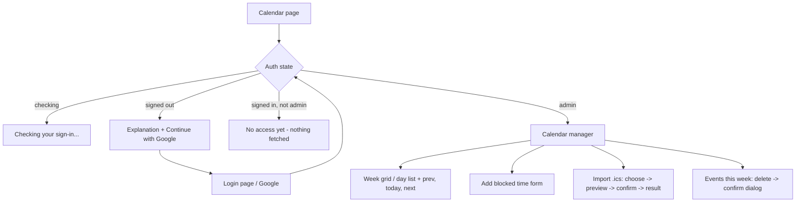
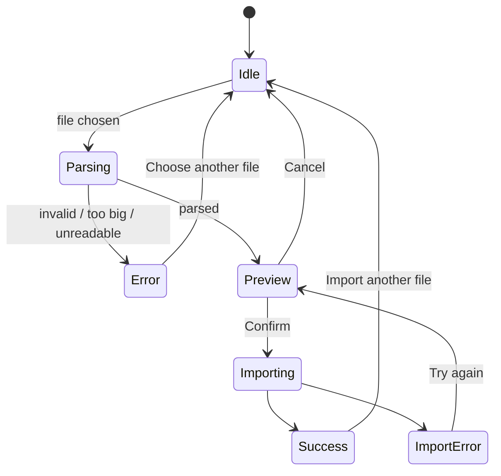

# Design: availability calendar (admin) + Google sign-in

Scope: ADR 0004 + 0005. Google sign-in (Microsoft shown as "coming soon"), admin-only calendar manager (week view, `.ics` import, manual blocked time, delete), plus the **spec** of the tutee read-only view (built, **not routed**: `TUTEE_CALENDAR_ENABLED = false`). Mobile first, WCAG 2.2 AA, tokens and components from `skeleton.md`; no raw hex, no new tokens.

Owner decisions applied: opening hours **08:00-22:00 every day incl. weekends**; recurring events in imported files expand **at most 12 months ahead**; **Google only**; times shown in **Europe/Brussels**; week starts **Monday**.

## 1. Flows



## 2. Home page sign-in states (`/`)

The landing page uses the shared `useAuth()` state rather than a static sign-in action. While the session is resolving it shows the polite status message **“Checking your sign-in...”**. Signed-out and auth-error states retain the **“Sign in”** link to `/login`. A signed-in tutor sees **“You are signed in as the tutor.”** and **“Go to calendar”** (`/calendar`); a signed-in non-tutor sees **“You are signed in, but the tutor has not given you access yet.”** with no sign-in button. The lead text changes to describe managing tutoring access and availability for signed-in users.

A successful OAuth callback is cleaned up after the session resolves and routes once to `#/calendar`; the calendar guard remains responsible for displaying the non-tutor no-access state.
## 2. Login page and sign-in state (`/login`)

`PageHeading` "Sign in", lead "Use your Google account. The tutor will approve your access." (Microsoft sentence removed.)

States (all inside `Container`, status area is one persistent live region above the buttons):

| State | UI |
|---|---|
| Signed out (default) | Buttons stacked, full width: **"Continue with Google"** (secondary, enabled) and **"Continue with Microsoft"** (see below). |
| Redirecting | After click: Google button `loading` (`aria-busy`, label kept), other button disabled. Text unchanged. |
| Session check on load | `StatusMessage info`: "Checking your sign-in..." (no buttons shown until known, avoids flash). |
| Signed in, admin | `StatusMessage success` "You are signed in." + `ButtonLink` primary "Go to calendar" + secondary Button "Sign out". |
| Signed in, not admin | `StatusMessage info` title "You don't have access yet": "You are signed in, but the tutor has not given you access to the calendar. Access requests are coming soon." + Button "Sign out". |
| Sign-in cancelled (provider `access_denied`) | `StatusMessage info`: "Sign-in was cancelled. You can try again." |
| Sign-in failed | `StatusMessage error`: "We couldn't sign you in with Google. Try again. If it keeps happening, contact the tutor." |
| Network error | `StatusMessage error`: "We couldn't reach the sign-in service. Check your connection and try again." |
| Sign-out failed | `StatusMessage error`: "We couldn't sign you out. Try again." |

**Microsoft button**: visible text "Continue with Microsoft (coming soon)". Use `aria-disabled="true"` (not `disabled`) so it stays focusable and can be described: `aria-describedby` -> hint "Microsoft sign-in is not available yet." (`--text-sm`, muted, below the button). Click is a no-op. Button styles `[aria-disabled="true"]` like `:disabled` (opacity 0.6, no hover change). Never hide the label inside an icon.
The adapter's typed "not available" error is not shown to users because the button cannot trigger it.

**Header (`Layout`)**: signed out `Home | Calendar | Sign in`; signed in `Home | Calendar | [Sign out]`. "Sign out" is a `Button variant="secondary"` styled to match nav items (min 44px), not a link, because it acts. After sign-out: navigate to `/`, focus `main`, announce via the live region "You have been signed out." (`StatusMessage success` on Home, one-off).
`aria-current="page"` rules from the skeleton are unchanged. No email or name is shown (data minimisation; the client does not know it).

Document titles: `Sign in · Tutoring`, `Calendar · Tutoring`.

## 3. Calendar page (`/calendar`)

`PageHeading` "Calendar". Content by state:

| State | UI |
|---|---|
| Auth checking | `StatusMessage info` "Checking your sign-in..." |
| Signed out | Paragraph "Sign in to see the calendar." + `Button` "Sign in with Google" (starts sign-in directly; label identical to the login action in the page context). No data fetched, nothing leaked. |
| Signed in, not admin | `StatusMessage info`, title "You don't have access yet": "Your account is signed in, but the calendar is not available to you yet. The tutor will give you access once requests are open." (no fetch) |
| Admin | Calendar manager (below). |

### 3.1 Admin page layout (mobile first, single column)

```
h1 Calendar
[Add blocked time] form      <- section h2 "Add blocked time"
[Import from calendar file]  <- section h2 "Import a calendar file"
h2 "Week view"
  Times are shown in Brussels time (CET, UTC+1). Tutoring hours: 08:00-22:00, every day.
  [< Previous week] [Today] [Next week >]     "23 - 29 November 2026"
  Legend: blank Free | hatch "Closed" | solid ✕ "Blocked"
  <week table (>=40rem) | day list (<40rem)>
h2 "Events this week"
  list, each with Delete
```

Order: week view first on desktop is more useful than forms. Use this DOM/visual order: h1, week view section, events section, add form, import section. Page-level `nav`-like "Jump to" links are unnecessary (4 sections, headings navigable).

Desktop (>=64rem): week view full width; add form and import side by side below (2 columns), events list above them. Mobile: single column, same order.

### 3.2 Time zone label

Always visible directly under the section heading, `--text-sm` muted: **"Times are shown in Brussels time (CET, UTC+1)."** abbreviation/offset computed for the displayed week (CEST, UTC+2 in summer; if the week contains a DST change say "(CET/CEST: clocks change on Sunday 25 October)"). Second sentence: **"Tutoring hours: 08:00-22:00, every day. Other hours are closed."** If the device time zone differs: append "Your device is set to <IANA zone>." Dates/times use 24-hour format (en-GB style, "Tue 24 Nov", "09:30").

### 3.3 Week navigation

- Group `role="group"` `aria-label="Week navigation"`: `Button secondary` **"Previous week"**, **"Today"**, **"Next week"**. Labels are visible text; arrows `‹ ›` optional, `aria-hidden`. "Today" is `aria-disabled`-free (always enabled; no-op when already on the current week, still announces).
- Range label (`<h3>`-less `<p id="week-range" aria-live="polite" aria-atomic="true">`): "23 - 29 November 2026" (cross-month "30 Nov - 6 Dec 2026"; cross-year includes both years). Changes are announced politely.
- Navigation is unbounded for admin; the data request is per displayed week (RPC range cap is not hit).
- Focus stays on the pressed button after navigation.

### 3.4 Week table (>=40rem)

Native `<table>`, **not** `role="grid"` (cells are not interactive in this release; SR table navigation works out of the box).

```
<table aria-describedby="week-tz-note" aria-busy={loading}>
  <caption class="visually-hidden">Availability for the week of 23 to 29 November 2026, Brussels time</caption>
  <thead> <tr> <td></td>  <th scope="col">Mon 23 Nov</th> ... <th scope="col" aria-current="date">Tue 24 Nov <span>Today</span></th> ... </tr>
  <tbody>
    <tr> <th scope="row">Before 08:00</th>  7 x Closed cells (one row, whole closed morning) </tr>
    <tr> <th scope="row">08:00</th> ... 28 half-hour rows 08:00..21:30 </tr>
    <tr> <th scope="row">After 22:00</th>  7 x Closed cells </tr>
```

- Rows: one "Before 08:00" row, 28 half-hour rows (label shows start time "08:00", full range in each cell's hidden text "08:00-08:30"), one "After 22:00" row. Closed hours are therefore **visible, textual and always blocked**, but do not blow up the table height. Row-header labels shown for every row (also :30 rows, in muted, `--text-sm`) so reading is easy at 200% zoom.
- `thead` top-left cell is an empty `<td>`; the "Today" column header carries a visible "Today" word plus `aria-current="date"` and a 3px bottom border (not colour only).
- Sticky `thead` below the app header (`position: sticky; top: <header height>`), and `scroll-padding-top` already covers focus.
- Table width 100% of container; min-width 40rem is satisfied by breakpoint, no horizontal scroll at 320px because the mobile list is used. If a user zooms to 200% at desktop width the layout switches to the list (media query on width). Never rely on horizontal scroll.

**Cell states** (each cell contains text; free cells hide it visually but expose it to AT):

| State | Visual | Text / glyph | Condition |
|---|---|---|---|
| Free | `--color-surface`, 1px `--color-border-subtle` grid lines | visually hidden "Free" | no overlap |
| Blocked | `--color-surface-alt`, 4px left bar `--color-border`, | `✕` (aria-hidden) + visible "Blocked" (`--text-sm`) | cell fully covered by event(s) |
| Partly blocked | `--color-surface-alt`, dashed 2px left bar `--color-border` | `◐` (aria-hidden) + visible "Part" with hidden "Partly blocked" | event covers only part of the half hour |
| Closed | `repeating-linear-gradient(135deg, transparent 0 6px, var(--color-border-subtle) 6px 8px)` over `--color-surface-alt` | `🔒`-free: glyph `—` (aria-hidden) + visible "Closed" | outside 08:00-22:00 |

Text colours use `--color-text` / `--color-text-muted` (>=7.3:1 on `surface-alt`). The hatch is decorative reinforcement; meaning is carried by the word. Adjacent blocked cells of the same event in a column merge visually (no border between) but remain separate cells in the DOM (no `rowspan`, keeps table navigation simple). In **admin mode** the first cell of each event shows its title (truncate with ellipsis, full title in `title`-free hidden text: "Blocked: <title>"); following cells show "Blocked". Overlapping events: cell shows "Blocked" + first title and hidden " and N more".
Closed row cells that also overlap an event are still "Closed" (closed wins; event stays visible in the list).

**Legend** (above table, `<ul>` inline, each item glyph + word): "Free (empty)", "Blocked ✕", "Closed (hatched)". Present in both table and list modes.

### 3.5 Day list (<40rem)

For each of the 7 days a `<section aria-labelledby>`: `<h3>` "Tue 24 Nov" (+ "Today" text badge when today, `aria-current="date"` on the heading), followed by `<ul>` of consecutive intervals, derived from `blockedIntervals`:

```
Tue 24 Nov  Today
  â–¢ Free     08:00-09:00
  ✕ Blocked  09:00-10:30      [admin: "Maths class"]
  â–¢ Free     10:30-22:00
  — Closed   00:00-08:00 / 22:00-24:00   (shown first and last, muted)
```

Each `<li>` = glyph (aria-hidden) + state word + "09:00-10:30" (`<time>`-less plain text). Order chronological: "Closed until 08:00" first, then day items, then "Closed from 22:00". Days with no events: "Free 08:00-22:00" single item. Item min-height 44px not required (non-interactive) but padding `--space-3`. h2 "Week view" > h3 days, so heading order is valid. On load, today's section is *not* auto-scrolled (avoids focus/scroll surprises); the "Today" button brings the week into view.

### 3.6 Week data states

| State | UI |
|---|---|
| Loading | Keep previous week rendered, `aria-busy="true"` on the table/list container, reduce opacity to 0.6; on first load show `StatusMessage info` "Loading the calendar..." in place of the grid (no skeleton component). Navigation buttons stay enabled; latest request wins. |
| Loaded, no events | Grid renders normally; below the legend `StatusMessage info`: "Nothing is blocked this week except closed hours." |
| Error | Replace grid with `StatusMessage error`: "We couldn't load the calendar. Check your connection and try again." + `Button secondary` "Try again". Focus is not moved; the alert is announced. |
| Not allowed (RPC/RLS rejection, e.g. role lost) | `StatusMessage warning`: "You no longer have access to this calendar. Sign in again with the right account." + Button "Sign out". |

## 4. Admin tools

Shared form pattern (new `Field`): visible `<label>`, optional hint (`aria-describedby`), error text under the control (`aria-describedby` + `aria-invalid="true"`), required marked with the words "(required)" in the label, not an asterisk only. Inputs min-height `--tap-target`, 1px `--color-border`, radius `--radius-md`, text `--text-base` (>=16px prevents iOS zoom). Native `<input type=date|time|file|text>` (best mobile/keyboard support). Validation runs **on submit** (and re-validates changed fields afterwards); no errors while typing.

On failed submit: an error summary `StatusMessage error` ("Please fix N problem(s) below.") with a list of links to the fields is rendered above the form and receives focus (`tabIndex=-1`); each field also shows its own message. On success: reset form, `StatusMessage success` in the live region, focus stays on the first field of the form.

### 4.1 Add blocked time (`<form>`, h2 "Add blocked time")

Lead: "Block a time so tutees can see you are not available."

| Field | Control | Rules |
|---|---|---|
| Date (required) | `type="date"`, default empty | required |
| Start time (required) | `type="time"` `step="300"` | required |
| End time (required) | `type="time"` `step="300"` | required, after start |
| Title (optional) | `type="text"` `maxlength=200` | hint: "Only you can see the title. Tutees see just that the time is blocked." Counter appears at >=180 chars: "20 characters left" (`aria-live=polite`). |

Buttons: primary **"Add blocked time"** (loading state while saving, label kept). Layout: Date full width; Start/End side by side from 24rem (fieldset-free, three labelled inputs); Title full width.

**Validation messages**

| Case | Message (under field; also in summary) |
|---|---|
| Date empty | "Enter a date." |
| Start empty | "Enter a start time." |
| End empty | "Enter an end time." |
| End <= start | "End time must be after the start time. To block past midnight, add a second entry for the next day." |
| Title > 200 | "Title must be 200 characters or fewer." |
| Whole range outside 08:00-22:00 (e.g. 22:30-23:30) | Error on End: "This time is already closed (08:00-22:00 is the only open time), so there is nothing to block." Not saved. |
| Partly outside (e.g. 07:00-09:00) | **Not an error.** Live polite info under the End field once all three values are valid: "Part of this time is outside 08:00-22:00, which is always blocked. It will be saved as you entered it." |
| Invalid/ambiguous local time (DST gap/overlap, 2026-03-29, 2026-10-25) | Inside open hours these cannot occur (changes happen at 02:00-03:00), so no message needed. |
| Server error | `StatusMessage error` "We couldn't save the blocked time. Try again." Form values kept. |
| Success | `StatusMessage success` "Blocked time added: Tue 24 Nov, 14:00-15:30." The week view jumps to that date's week if different and shows "Week of ... shown." |

Past dates are allowed (no message).

### 4.2 Import a calendar file (section h2 "Import a calendar file")

Lead: "Export your calendar as an .ics file from Outlook, Google Calendar or Apple Calendar and import it here. Events become blocked time. Only titles are kept; descriptions, locations and attendees are never read or stored. Repeating events are included for up to 12 months ahead."

A small step state machine inside one section; the section content is replaced per step and the new step's heading/status receives focus.



1. **Idle**: `Field` "Calendar file (.ics, up to 1 MB)" with native `<input type="file" accept=".ics,text/calendar">`. Choosing a file starts parsing immediately (no extra "Upload" click). Below: `Button secondary` "Remove all imported events" (opens confirm dialog, §4.3) shown only when imported events exist, hint "Imported until 24 Nov 2027." (max occurrence date of imported events, text "Imported until <date>. Import again before then to keep repeating events up to date.").
2. **Parsing**: file input disabled, `StatusMessage info` "Reading <file name>..." (`aria-busy`). `ical.js` is lazy-loaded here, so first run may take a moment.
3. **Preview** (`h3` "Check before importing", receives focus):
   - Summary list (`<dl>`):
     - "Found: **42** events" (counts occurrences after expansion)
     - "Will be added: **38**"
     - "Already in your calendar (duplicates, left unchanged): **3**"
     - "Skipped: **1**" -> each reason is a line: "Cancelled: 1", "Marked as free: 2", "In the past: 5", "Longer than 31 days: 0", "After <date> (12-month limit): 0". Reasons with count 0 are hidden.
     - "Dates: 24 Nov 2026 - 20 Nov 2027" and "Repeating events included until 24 Nov 2027." (+ "including N occurrences of repeating events")
   - Warnings (`StatusMessage warning`, only when relevant): "Some events use a time zone we don't know. They were read as Brussels time." / "Only the first 2000 occurrences were read. Repeating events are cut off after <date>."
   - **Preview list**: `<table>` (Title, Date, Time, Status) with caption "Events found in <file name>", first 50 rows, `Button secondary` "Show 50 more" (focus moves to first newly shown row heading... simpler: keep focus on the button, announce "Showing 100 of 154" in a polite status). Status column text: "Will be added" / "Already imported" / "Skipped: cancelled"; skipped and duplicate rows are muted but still full-contrast text. On <40rem the table becomes a stacked list (`<ul>` with `<dl>` per item).
   - Actions: primary **"Import 38 events"** (disabled via `aria-disabled` + hint when 0 to add: "There is nothing new to import."), secondary **"Choose another file"** (back to Idle), tertiary **"Cancel"** is merged into "Choose another file" (one fewer button).
   - If 0 importable and 0 duplicates: `StatusMessage info` "No events to import. Cancelled events, events marked as free and past events are skipped."
4. **Importing**: Confirm button `loading`, other controls disabled.
5. **Success**: `StatusMessage success` (title "Import complete"): "38 events imported. 3 were already in your calendar. 1 was skipped." + `Button secondary` "Import another file". Week view and events list refresh and the view jumps to the first imported week if the current week has none (announced: "Showing week of ...").
6. **Errors** (`StatusMessage error`, `role=alert`, with next action "Choose another file"):
   - Wrong type: "That doesn't look like a calendar file. Choose a file that ends in .ics."
   - Too large: "This file is larger than 1 MB. Export a shorter date range and try again."
   - Cannot read: "We couldn't read this calendar file. It may be damaged. Export it again and retry."
   - Save failed (ImportError): "We couldn't save the events. Nothing was imported. Try again." with `Button` "Try again" (returns to Preview with selection kept).

### 4.3 Events list and delete (h2 "Events this week")

Follows the displayed week. `<ul>` (not a table; works at 320px): each `<li>`:

```
Maths class                               [Delete]
Tue 24 Nov, 14:00-15:30 · Added manually   (or "Imported from calendar file")
```

- Title or muted "No title". Text "Added manually" / "Imported from calendar file" (not colour or icon only). Events spanning days show both dates: "Mon 23 Nov 22:00 - Tue 24 Nov 02:00".
- `Button secondary` "Delete" with `aria-label="Delete <title or 'untitled event'>, Tue 24 Nov 14:00-15:30"`. Visible text "Delete" is contained in the name (WCAG 2.5.3).
- Empty: `StatusMessage info` "No blocked events this week." Loading/error as §3.6 (shared).
- Order: by start time.

**Delete confirm** (`Dialog`, title "Delete this event?"): body "<title or Untitled event>, Tue 24 Nov, 14:00-15:30. Tutees will see this time as free again, unless it is closed hours or covered by another event." Buttons: primary **"Delete event"** (loading while saving), secondary **"Keep event"**. Initial focus on "Keep event" (safe default). Esc / Keep closes; focus returns to the originating Delete button, or if it was deleted, to the "Events this week" heading (`tabIndex=-1`). Success: live `StatusMessage success` "Event deleted." (persistent region, announced). Error: stays open, inline `StatusMessage error` "We couldn't delete the event. Try again."
**Remove all imported**: same dialog, title "Remove all imported events?", body "This removes 124 imported events. Events you added by hand stay. Tutees will see those times as free again." Buttons "Remove imported events" / "Keep events". Success "124 imported events removed."

## 5. Keyboard and ARIA

| Area | Behaviour |
|---|---|
| Week table | Static table: no tab stops inside; SR users use table navigation (header associations via `th scope`). `caption` names it. No scroll container, so nothing to focus. |
| Navigation | Tab order: Previous week, Today, Next week (Enter/Space). Range text in polite live region. |
| Forms | Native controls; Enter submits; error summary link moves focus to the field. |
| Import | File input is native (Enter/Space opens picker); steps move focus to the new step heading or status (`tabIndex=-1`). |
| Dialog | Native `<dialog>` with `showModal()`: focus trap and Esc built in; `aria-labelledby` title, `aria-describedby` body; background inert; focus restore as above. |
| Live regions | One persistent polite region per feature area (calendar manager) for success/loading texts; errors use `role="alert"` via `StatusMessage`. Do not mount the region together with its first message. |
| Future (booking) | When cells become actionable, convert the table to `role="grid"` with roving `tabindex` (Arrow keys move cell by cell, Home/End row ends, PageUp/PageDown previous/next week, Enter/Space select). Not built now. |

Other: all interactive targets >=44px, 3px focus ring from the global style, reduced motion removes the loading opacity transition, works at 320px/200% text (list mode), `html lang="en"`.

## 6. Tutee read-only view (specified, built, not routed)

Same `CalendarWeekView` with `mode="tutee"`, fed only by `BlockedTimeRepository` merged intervals. Not behind a route until `TUTEE_CALENDAR_ENABLED` flips (access-approval feature).

- Heading "Availability"; lead "Times marked Blocked are not available. Everything else in tutoring hours is free." Time-zone note identical to §3.2.
- Same week table / day list, navigation, legend (Free, Blocked, Closed). **No titles, no counts, no event list, no forms, no import, no delete.** Cell text only "Free", "Blocked", "Closed". "Partly blocked" is kept (derived from intervals alone). Adjacent events are merged by the server so boundaries reveal nothing.
- States: loading (as §3.6), error ("We couldn't load the availability. Check your connection and try again." + Try again), no access (`StatusMessage warning` "You don't have access to the availability yet."), empty ("The tutor has no blocked time this week, apart from closed hours.").
- Table is still non-interactive (no slot selection yet); request-a-slot is a later feature.

## 7. Components

**Reuse unchanged**: `Container`, `PageHeading`, `StatusMessage`, `Button`, `ButtonLink`, `Layout` (header gets auth control), `SkipLink`.
**Small change to existing `Button`**: support `aria-disabled="true"` styling identical to `:disabled` and ignore clicks when it is set (used for "coming soon" and "nothing to import").

**New reusable components** (`src/shared/ui/` unless noted; CSS Module, TSDoc, test each):

| Component | Props | Notes |
|---|---|---|
| `Field` | `label: string`, `hint?: string`, `error?: string`, `required?: boolean`, `children: (props: { id; 'aria-describedby'; 'aria-invalid' }) => ReactNode` | Wires label/hint/error ids; renders "(required)" text; used for text, date, time, file inputs. |
| `TextInput` | native `input` attributes (`type` text/date/time/file), `invalid?: boolean` | Styled input per tokens; used inside `Field`. |
| `Dialog` | `open: boolean`, `title: string`, `onClose: () => void`, `children`, `initialFocus?: 'close' \| 'first'` | Native `<dialog>` + `showModal()`, labelled by title, restores focus, Esc closes. |
| `ConfirmDialog` | `open`, `title`, `children` (body), `confirmLabel`, `cancelLabel`, `onConfirm: () => Promise<void> \| void`, `onCancel`, `error?: string`, `busy?: boolean` | Built on `Dialog`; initial focus on cancel; confirm shows loading. Reused by delete / remove-all and future accept/decline. |
| `ErrorSummary` | `errors: { fieldId: string; message: string }[]`, `title?: string` | Focusable `StatusMessage error` with links to fields. |
| `features/calendar/CalendarWeekView` | `weekStart: IsoDate`, `mode: 'admin' \| 'tutee'`, `blocked: Interval[]`, `events?: CalendarEvent[]` (admin only), `status: 'loading' \| 'ready' \| 'error'`, `onRetry` | Picks table vs day list; composes the pieces below. |
| `features/calendar/WeekTable` / `DayList` | `days: DayModel[]` (view model from pure functions: per cell/interval `{ state, label, title? }`) | Presentational; no date maths inside. |
| `features/calendar/WeekNavigator` | `rangeLabel: string`, `onPrevious`, `onToday`, `onNext` | Group + live range text. |
| `features/calendar/TimeZoneNote` | `weekStart`, `timeZone`, `hours` | Builds the "Times are shown in..." text. |
| `features/calendar/CalendarLegend` | none | Free / Blocked / Closed with glyphs. |
| `features/calendar/ImportPanel`, `AddBlockedTimeForm`, `EventList` | container/presentational split; callbacks via props | Admin tools. |
| `features/auth/AuthControls` | `status`, `onSignOut` | Header "Sign in"/"Sign out". |

Glyphs and `.visually-hidden` utility class go in `shared/styles` (add `.visually-hidden` to the global stylesheet if missing). No new tokens: Blocked = `--color-surface-alt`; admin event title cells may use `--color-info-bg`/`--color-info` bar (state is still carried by the text "Blocked").

## 8. Microcopy index (English)

Page/section: "Calendar", "Week view", "Events this week", "Add blocked time", "Import a calendar file", "Check before importing". Buttons: "Continue with Google", "Continue with Microsoft (coming soon)", "Sign in", "Sign out", "Sign in with Google", "Previous week", "Today", "Next week", "Add blocked time", "Import 38 events", "Choose another file", "Show 50 more", "Delete", "Delete event", "Keep event", "Remove all imported events", "Try again". Use sentence case, no exclamation marks, say what happened and what to do next.

## 9. Accessibility checklist (dev/QA additions)

- [ ] Table has caption, `th scope`, `aria-current="date"` on today; blocked/closed/free are identifiable by text for every cell (check with a DOM test, no colour-only).
- [ ] Closed hours always render as Closed (before 08:00, after 22:00), also on weekends and on DST days.
- [ ] Day list shown <40rem; no horizontal scroll at 320px; text resize to 200%.
- [ ] Forms: labels, `aria-invalid`, `aria-describedby`, error summary receives focus on failed submit.
- [ ] Dialog: focus trapped, Esc closes, focus returns, default focus on the safe action.
- [ ] Live messages announced (success, loading, errors via `role="alert"`).
- [ ] `aria-disabled` Microsoft button is focusable and described; click does nothing.
- [ ] Tutee view contains no title text in the DOM (assert in test).
- [ ] Tests use roles/names: `getByRole('button', { name: 'Continue with Google' })`, `getByRole('table', { name: /week of/i })`, `getByRole('dialog', { name: 'Delete this event?' })`.

