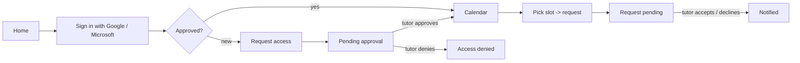

# Design: project skeleton

Scope: app shell, four placeholder pages, design tokens, four base components. Mobile first, WCAG 2.2 AA, CSS Modules + CSS variables (ADR 0002). No real features.

## 1. Future flow (outline only, not designed here)



Skeleton covers only Home, Login, Calendar (placeholder), Not found.

## 2. Design tokens

Defined once in `src/shared/styles/tokens.css` on `:root`; dark overrides inside `@media (prefers-color-scheme: dark)`. Components use only these variables (no raw hex).

### Colour (light, default)

| Variable | Hex | Use / contrast |
|---|---|---|
| `--color-bg` | `#ffffff` | Page background |
| `--color-surface` | `#ffffff` | Cards, header, footer |
| `--color-surface-alt` | `#f3f5f9` | Subtle panels, footer band |
| `--color-text` | `#1b1f2a` | Body text: 16.5:1 on bg |
| `--color-text-muted` | `#4a5163` | Secondary text: 7.9:1 on bg, 7.3:1 on surface-alt |
| `--color-border` | `#6b7280` | Controls/UI boundaries: 4.8:1 (≥3:1 required) |
| `--color-border-subtle` | `#d5d9e2` | Decorative dividers only (never the sole control boundary) |
| `--color-primary` | `#1d4ed8` | Primary button bg, links: 6.7:1 on bg |
| `--color-primary-hover` | `#1e40af` | Hover/active: 8.7:1 with white text |
| `--color-on-primary` | `#ffffff` | Text on primary: 6.7:1 |
| `--color-focus` | `#1d4ed8` | Focus ring: 6.7:1 on bg, 6.1:1 on surface-alt |
| `--color-success` / `-bg` | `#146c2e` / `#e7f6ec` | 5.9:1 |
| `--color-error` / `-bg` | `#b42318` / `#fdecea` | 5.8:1 |
| `--color-info` / `-bg` | `#1d4ed8` / `#e8effd` | 5.8:1 |
| `--color-warning` / `-bg` | `#7a4100` / `#fff4e0` | 7.5:1 |

### Colour (dark, via `prefers-color-scheme: dark`)

| Variable | Hex | Contrast |
|---|---|---|
| `--color-bg` | `#0f1420` | |
| `--color-surface` | `#181f2e` | |
| `--color-surface-alt` | `#1f2738` | |
| `--color-text` | `#e8ebf2` | 15.4:1 on bg, 13.8:1 on surface |
| `--color-text-muted` | `#a9b0c0` | 8.5:1 on bg, 7.6:1 on surface |
| `--color-border` | `#7a8398` | 4.8:1 on bg, 4.3:1 on surface |
| `--color-border-subtle` | `#2d364a` | decorative |
| `--color-primary` | `#8ab4ff` | 7.9:1 on surface |
| `--color-primary-hover` | `#a5c4ff` | |
| `--color-on-primary` | `#0f1420` | 8.8:1 on primary, 10.5:1 on hover |
| `--color-focus` | `#8ab4ff` | 7.9:1 on surface |
| `--color-success` / `-bg` | `#7ddc9a` / `#12281b` | 9.4:1 |
| `--color-error` / `-bg` | `#ff9b90` / `#331614` | 8.2:1 |
| `--color-info` / `-bg` | `#8ab4ff` / `#14233f` | 7.5:1 |
| `--color-warning` / `-bg` | `#ffc66b` / `#33250a` | 9.6:1 |

Also set `color-scheme: light dark` on `:root`. Contrast ratios were computed with the WCAG relative-luminance formula; re-check if values change.

### Spacing (4px base)

`--space-1: 0.25rem` · `--space-2: 0.5rem` · `--space-3: 0.75rem` · `--space-4: 1rem` · `--space-6: 1.5rem` · `--space-8: 2rem` · `--space-12: 3rem` · `--space-16: 4rem`

### Typography

Font: system stack, no webfont download: `--font-sans: system-ui, -apple-system, "Segoe UI", Roboto, "Helvetica Neue", Arial, sans-serif`. Base 16px (`html` font-size left at 100%; use `rem`).

| Variable | Size | Use |
|---|---|---|
| `--text-sm` | `0.875rem` | Footer, helper text |
| `--text-base` | `1rem` | Body (line-height `--leading-body: 1.6`) |
| `--text-lg` | `1.125rem` | Lead text |
| `--text-xl` | `1.375rem` | h3 |
| `--text-2xl` | `1.75rem` | h2 |
| `--text-3xl` | `clamp(1.75rem, 1.2rem + 2.5vw, 2.5rem)` | h1 |

`--leading-heading: 1.2`, `--weight-regular: 400`, `--weight-semibold: 600`. Respect user zoom/text resize to 200% without loss (no fixed heights on text containers).

### Shape, elevation, motion, layout

- `--radius-sm: 0.25rem` · `--radius-md: 0.5rem` · `--radius-lg: 0.75rem`
- `--shadow-sm: 0 1px 2px rgb(0 0 0 / 0.12)` (use sparingly; never as the only boundary)
- `--border-width: 1px`
- `--tap-target: 2.75rem` (44px min for interactive elements)
- `--container-max: 60rem`, `--container-pad: var(--space-4)` (`--space-6` from 40rem up)
- Breakpoints (use in `@media (min-width: …)`, mobile first): `40rem` (sm), `64rem` (lg). CSS variables cannot be used in media queries, so hard-code these.
- Motion: `--duration-fast: 120ms`; inside `@media (prefers-reduced-motion: reduce)` set transitions/animations to none.

### Focus ring

Global: `:focus-visible { outline: 3px solid var(--color-focus); outline-offset: 2px; }`. Never `outline: none` without a replacement. The 2px offset keeps it visible on filled primary buttons (ring contrasts with page bg, ≥3:1). Focused elements must not be hidden by sticky header (`scroll-padding-top` = header height).

## 3. App shell

```
┌ [Skip to main content]  (visible only on focus, first tab stop)
├ <header>  Brand "Tutoring"  ·  <nav aria-label="Main">  Home | Calendar | Sign in
├ <main id="main" tabindex="-1">   <Container> <PageHeading/> page content </Container>
└ <footer>  © year Name · small muted text
```

- Landmarks: one `header` (banner), one `nav` labelled "Main", one `main`, one `footer` (contentinfo).
- **Skip link**: first focusable element, `href="#main"` is not usable with HashRouter, so implement as a button/anchor with `onClick` that focuses `main` (`tabIndex={-1}`) and does not alter the hash. Visually hidden until `:focus`, then shown top-left with primary styling.
- **Nav**: horizontal list, wraps on narrow screens (no hamburger for 3 links; avoids hidden menu complexity). Links ≥44px tall. Current page marked with `aria-current="page"` plus a 3px underline (not colour only). Skeleton shows all three links; later guards hide/replace Calendar and show Sign out.
- **Route change**: on navigation, move focus to `main` (or the h1) and update `document.title` to `<Page> · Tutoring` so screen-reader users are informed.
- Footer sticks to bottom on short pages (`min-height: 100dvh` flex column layout).

## 4. Placeholder pages

Each page: one `<h1>` via `PageHeading`, within `Container`. Copy is placeholder and short.

| Route | Content |
|---|---|
| Home `#/` | h1 "Tutoring"; lead: "Personal tutoring sessions. Sign in to request access and book a time."; primary Button (link) "Sign in" → `#/login`. |
| Login `#/login` | h1 "Sign in"; text "Use your Google or Microsoft account. The tutor will approve your access."; two full-width stacked Buttons (secondary variant): "Continue with Google", "Continue with Microsoft" (text labels, icons optional and `aria-hidden`; follow provider brand guidelines if logos are added later). Skeleton handlers are no-ops that render a StatusMessage `info`: "Sign-in is not available yet." |
| Calendar `#/calendar` | h1 "Calendar"; StatusMessage `info`: "The availability calendar is coming soon." |
| Not found `*` | h1 "Page not found"; text "We could not find that page."; Button (link) "Back to home". |

## 5. Base components

All in `src/shared/ui/`, each with a CSS Module, typed props, TSDoc, and a test. Forward `className`-free API (no style overrides); extend via variants.

### Button

- Props: `variant: 'primary' | 'secondary'` (default primary), `fullWidth?`, `loading?`, native `button` attributes; `type` defaults to `"button"`.
- Link variant: `ButtonLink` (or `as` prop) rendering a router `<Link>` styled identically for navigation actions; links navigate, buttons act.
- Styles: min-height `--tap-target`, padding `--space-3 --space-6`, radius `--radius-md`, weight semibold. Primary: bg `--color-primary`, text `--color-on-primary`, hover `--color-primary-hover`. Secondary: bg `--color-surface`, 1px `--color-border`, text `--color-text`, hover bg `--color-surface-alt`. 
- States: hover, `:focus-visible` (global ring), active, disabled (`disabled` attribute, opacity 0.6; disabled controls are exempt from contrast but label stays legible), loading (`aria-busy="true"`, `disabled`, text label retained, optional spinner `aria-hidden`; spinner disabled under reduced motion).
- Accessible name = visible label text.

### Container (Layout)

- `Container`: centred, `max-width: var(--container-max)`, horizontal padding `--container-pad`, vertical padding `--space-8`. Renders a `div` (optional `as`).
- `Layout` (in `src/app/`): renders SkipLink, header + nav, `<main id="main" tabIndex={-1}>` wrapping `Outlet`, footer. Owns the landmarks above.

### PageHeading

- Props: `children`, optional `lead?: string` (renders paragraph below). Always renders `h1` (one per page); style `--text-3xl`, margin-bottom `--space-4`.
- Receives programmatic focus on route change if designated focus target (`tabIndex={-1}`); focus outline suppressed only for programmatic focus via `:focus:not(:focus-visible)`.

### StatusMessage

- Props: `status: 'info' | 'success' | 'warning' | 'error'`, `children`, optional `title`.
- Visual: bg `--color-<status>-bg`, 1px border + 4px left bar in `--color-<status>`, text `--color-text`, radius `--radius-md`, padding `--space-4`. Each status has a text-visible icon glyph (ℹ ✓ ⚠ ✕, `aria-hidden`) and a visually hidden prefix ("Information:", "Success:", "Warning:", "Error:") so meaning is not colour-only.
- Semantics: `error` → `role="alert"` (assertive); `info`/`success`/`warning` → `role="status"` (polite). To announce async changes, render the live region container persistently and change its content, rather than mounting it with content, where timing matters.
- Microcopy rule: say what happened and what to do next.

## 6. Accessibility requirements (checklist for dev/QA)

- [ ] Skip link is the first tab stop, visible on focus, moves focus to `main`.
- [ ] One h1 per page; headings in order; `document.title` updates per route; focus moves to main on navigation.
- [ ] All interactive elements ≥44×44px, keyboard operable (Tab, Enter/Space), visible 3px focus ring in both themes.
- [ ] Text contrast ≥4.5:1, UI boundaries/focus ≥3:1 using the tokens above in both themes.
- [ ] No colour-only meaning (nav current page, status messages).
- [ ] Layout works at 320px width and 200% zoom/text size with no horizontal scroll (WCAG reflow).
- [ ] `prefers-reduced-motion` disables transitions/animations.
- [ ] Landmarks: banner, labelled nav, main, contentinfo; `html lang="en"`; viewport meta without `user-scalable=no`.
- [ ] Links vs buttons used correctly; link text meaningful out of context.
- [ ] `eslint-plugin-jsx-a11y` passes; component tests assert roles/names (e.g. `getByRole('button', { name: 'Continue with Google' })`, `getByRole('alert')`).

## 7. Out of scope (later requests)

Access-request form, pending/denied screens, calendar grid and slot states (see skill `calendar-scheduling-ux`), tutor inbox, dialogs, form fields, timezone display. Add `Field`, `Dialog`, `StatusBadge` when first needed.
